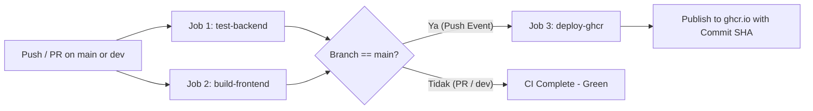

# 💳 BeresBayar — Sistem Pelacak & Manajemen Tagihan Finansial (Bill Tracker)

**Ujian Tengah Semester (UTS) — Konstruksi dan Evolusi Perangkat Lunak 2026**  
**Javian Oktaviansyah (24/541440/SV/24906)**  
*Program Studi Sarjana Terapan Rekayasa Perangkat Lunak, Departemen TEDI, Sekolah Vokasi, Universitas Gadjah Mada*  
*Repositori Publik:* [https://github.com/javian67/uts-pl-24-541440-SV-24906.git](https://github.com/javian67/uts-pl-24-541440-SV-24906.git)

---

## 📋 Ikhtisar Proyek

**BeresBayar** adalah aplikasi web *client-server* terpadu untuk pencatatan, pemantauan, dan manajemen tagihan keuangan pribadi (*personal bill tracker*). Permasalahan utama yang diselesaikan adalah kebiasaan mahasiswa dan individu yang kerap **terlambat atau lupa membayar tagihan rutin** (seperti sewa kos bulanan, listrik/utilitas PLN, tagihan air PDAM, langganan internet WiFi IndiHome, hingga layanan hiburan seperti Spotify dan Netflix) karena tanggal jatuh tempo yang tersebar, ketiadaan rekapitulasi nominal akumulatif yang terpusat, serta risiko denda pemutusan layanan.

Sistem ini dibangun dengan arsitektur **Decoupled Monorepo** yang memisahkan sisi *Backend RESTful API* dan *Frontend Single Page Application (SPA)*. Seluruh layanan dikontainerisasi penuh menggunakan **Docker Compose** dengan orkestrasi 3-tier (*database*, *backend*, dan *frontend*), komunikasi aman melalui *Docker Bridge Network*, serta diotomatisasi melalui alur kerja **CI/CD GitHub Actions** yang mencakup pengujian otomatis backend, kompilasi frontend, dan deployment image ke **GitHub Container Registry (GHCR)**.

### ✨ Karakteristik & Fitur Unggulan Sistem:
1. **Autentikasi Aman & Isolasi Data Per-User:** Menggunakan **Laravel Sanctum (Bearer Token)** dengan relasi kepemilikan tagihan (`user_id`). Setiap pengguna hanya dapat mengakses, mengubah, dan menghapus tagihannya sendiri (mencegah *Information Disclosure* / IDOR).
2. **RESTful API Semantik:** Mendukung operasi CRUD penuh (`/api/bills`) dengan kode status HTTP terstandarisasi (`200 OK`, `201 Created`, `401 Unauthorized`, `404 Not Found`, `422 Unprocessable Entity`).
3. **Desain Brutalist RawBlock:** Mengadopsi **RawBlock Design System** pada antarmuka pengguna—kontras tinggi hitam-putih, tipografi *Archivo Black* dan *Space Mono*, border tegas 3–5px tanpa rounded corner (`radius: 0px`), visual tension, serta status chip berkode warna fungsional.
4. **Dashboard Interaktif & Metrik Finansial:** Kartu ringkasan metrik real-time menghitung Total Akumulasi Tagihan, Total Belum Dibayar (dengan border error 5px penanda urgensi), dan Total Sudah Dibayar (lunas).
5. **Axios Global Interceptors:** Penanganan Bearer token otomatis pada setiap *request header* dan deteksi sesi kedaluwarsa (`401 Unauthorized`) dengan auto-redirect ke halaman login.
6. **Nginx FastCGI Reverse Proxy:** Frontend Nginx tidak hanya menyajikan berkas build statis Vue 3, melainkan juga bertindak sebagai reverse proxy yang meneruskan seluruh permintaan `/api` secara transparan via FastCGI ke port internal `backend:9000`.

---

## 🗂️ Struktur Repository

```text
uts-pl-24-541440-SV-24906/
├── .github/
│   └── workflows/
│       └── ci.yml                 # Alur kerja otomatisasi CI (Test & Build) dan CD (Publish ke GHCR)
├── backend/                       # RESTful API berbasis Laravel 11 & PHP 8.4-FPM
│   ├── app/
│   │   ├── Http/Controllers/Api/  # AuthController & BillController
│   │   └── Models/               # Model User & Bill (Relasi HasMany & BelongsTo)
│   ├── database/
│   │   ├── migrations/           # Migrasi tabel users, bills, personal_access_tokens
│   │   └── seeders/              # DatabaseSeeder akun pengujian
│   ├── routes/
│   │   └── api.php               # Rute publik & terproteksi middleware auth:sanctum
│   ├── tests/
│   │   └── Feature/              # Pengujian otomatis BillTest.php (10 test cases)
│   ├── .dockerignore
│   ├── composer.json             # Dependensi PHP & Laravel Boost / Pint / PHPUnit
│   └── Dockerfile                # Image PHP 8.4-FPM dengan layer caching Composer
├── frontend/                      # Single Page Application berbasis Vue.js 3 & Vite
│   ├── src/
│   │   ├── api/                  # Axios instance + Global Request/Response Interceptors
│   │   ├── components/           # BillFormModal, ConfirmModal, Navbar
│   │   ├── router/               # Vue Router dengan Navigation Guards (guestOnly & requiresAuth)
│   │   ├── stores/               # Pinia state management (auth.js & bills.js)
│   │   ├── views/                # LoginView, RegisterView, BillsDashboard
│   │   └── style.css             # Konfigurasi utility Tailwind & RawBlock brutalism tokens
│   ├── .dockerignore
│   ├── default.conf              # Konfigurasi Nginx SPA routing & FastCGI proxy rute /api
│   ├── Dockerfile                # Multi-stage build (Node.js 18 builder -> Nginx Alpine runner)
│   ├── package.json              # Dependensi Vue 3, Pinia, Axios, Tailwind CSS v3
│   ├── rawblock-DESIGN.md        # Panduan pedoman desain sistem brutalism RawBlock
│   └── vite.config.js            # Konfigurasi bundler Vite
├── .env.example                   # Template variabel lingkungan untuk Docker Compose stack
├── APIpostman.json                # Koleksi resmi pengujian Postman (7 operasi endpoint API)
├── docker-compose.yml             # Konfigurasi orkestrasi 3 service (db, backend, frontend)
└── README.md                      # Dokumentasi komprehensif proyek
```

---

## 🚀 Menjalankan dengan Docker Compose (Rekomendasi Utama)

Seluruh service aplikasi dikonfigurasikan agar dapat dijalankan dalam 1 kali perintah melalui **Docker Compose**. Komunikasi antar-service berlangsung melalui jaringan bridge internal bernama `beresbayar_network` menggunakan **nama service internal Docker** (`db`, `backend`, `frontend`).

### 1. Langkah Instalasi & Eksekusi:

1. **Klon repositori ke komputer lokal:**
   ```bash
   git clone https://github.com/javian67/uts-pl-24-541440-SV-24906.git
   cd uts-pl-24-541440-SV-24906
   ```

2. **Siapkan berkas environment dari template `.env.example`:**
   ```bash
   cp .env.example .env
   ```

3. **Konfigurasikan nilai rahasia di berkas `.env`:**
   Pastikan variabel kunci terisi (kunci enkripsi Laravel dapat diisi string base64 atau dibiarkan bawaan jika sudah diatur):
   ```env
   # Laravel Application
   APP_NAME=BeresBayar
   APP_ENV=production
   APP_DEBUG=false
   APP_KEY=base64:3u2J8PtzNv6bbM1Kp10NkBh9nkgfpfB2TFvQ8zm3m59=
   APP_URL=http://localhost:8000

   # Database Configuration (MySQL 8.0)
   DB_CONNECTION=mysql
   DB_HOST=db
   DB_PORT=3306
   DB_DATABASE=beresbayar
   DB_USERNAME=beresuser
   DB_PASSWORD=berespassword123
   DB_ROOT_PASSWORD=beresroot123
   ```

4. **Bangun dan jalankan seluruh container stack:**
   ```bash
   docker compose up -d --build
   ```

5. **Inisialisasi database (Migrasi & Seeder):**
   Jalankan migrasi tabel ke dalam container backend:
   ```bash
   docker compose exec backend php artisan migrate --force
   docker compose exec backend php artisan db:seed --force
   ```

---

### 🌐 Akses Layanan Aplikasi:

| Komponen Sistem | Alamat URL / Akses | Keterangan |
| :--- | :--- | :--- |
| **Frontend Web UI (SPA)** | [http://localhost](http://localhost) (Port 80) | Antarmuka pengguna Vue 3 yang disajikan via Nginx |
| **Backend REST API** | [http://localhost/api](http://localhost/api) | Diteruskan via FastCGI reverse proxy Nginx ke backend |
| **Direct Backend Port** | [http://localhost:8000](http://localhost:8000) | Pemetaan port host ke port 9000 container backend |
| **Basis Data MySQL** | `localhost:3306` | Akses koneksi database langsung dari tool visual (DBeaver/Navicat) |

### 👥 Kredensial Akun Pengujian:

Pengguna dapat mendaftar langsung secara mandiri melalui form **REGISTER** di antarmuka web, atau menggunakan kredensial bawaan hasil seeder:

| Parameter | Kredensial Default | Catatan |
| :--- | :--- | :--- |
| **Email Pengguna** | `javian123@example.com` *(atau akun baru)* | Terdaftar pada database dan koleksi Postman |
| **Kata Sandi** | `password123` | Terenkripsi dengan algoritma `bcrypt` |
| **Akun Seeder Tambahan** | `test@example.com` / `password` | Dibuat saat eksekusi `DatabaseSeeder` |

### 💾 Manajemen Data & Persistensi:

* **Menghentikan container (Data database tetap tersimpan aman di volume):**
  ```bash
  docker compose down
  ```
* **Melihat status service dan port yang terbuka:**
  ```bash
  docker compose ps
  ```
* **Melihat log container backend & frontend:**
  ```bash
  docker compose logs backend
  docker compose logs frontend
  ```
* **Menghentikan sistem sekaligus mereset seluruh volume data database:**
  ```bash
  docker compose down -v
  ```

---

### 🏗️ Arsitektur Service Docker

| Service | Base Image | Konfigurasi Port & Volume | Peran Arsitektural |
| :--- | :--- | :--- | :--- |
| **`db`** (`beresbayar_db`) | `mysql:8.0` | Port: `3306:3306`<br>Volume: `db_data:/var/lib/mysql` | Menyimpan seluruh data relasional tabel `users`, `bills`, dan `personal_access_tokens`. Persistensi dijamin oleh *Named Volume* `db_data`. |
| **`backend`** (`beresbayar_backend`) | `php:8.4-fpm` (Custom Build) | Port: `8000:9000`<br>Working Dir: `/var/www` | Menjalankan core aplikasi RESTful API Laravel 11. Terkoneksi ke `db:3306`. Melayani permintaan FastCGI dari service frontend pada port 9000. |
| **`frontend`** (`beresbayar_frontend`) | `nginx:alpine` (Multi-stage) | Port: `80:80`<br>Root: `/usr/share/nginx/html` | Menyajikan bundle kompilasi Vue 3 SPA. Menyediakan reverse proxy bawaan melalui `fastcgi_pass backend:9000` untuk setiap endpoint `/api`. |

> **Diagram Alur Data Sistem:**  
> `Web Browser (Klien)` $\longrightarrow$ `Frontend Nginx (Port 80)`  
> ├── Request Halaman Web (`/`, `/dashboard`, `/login`) $\longrightarrow$ Disajikan langsung oleh `Nginx` (File Statis SPA)  
> └── Request API (`/api/*`) $\longrightarrow$ Proxy FastCGI $\longrightarrow$ `Backend PHP 8.4-FPM (Port 9000)` $\longrightarrow$ `Database MySQL 8.0 (Port 3306)`

---

## 💻 Menjalankan Tanpa Docker (Pengembangan Lokal)

Jika ingin menjalankan aplikasi secara langsung di lingkungan host pengembang:

### 1. Prasyarat Sistem:
* PHP versi $\ge$ 8.3 dengan ekstensi `pdo_mysql`, `mbstring`, `bcmath`, `xml`, `curl`
* Composer 2.x
* Node.js versi 18 atau lebih baru & npm
* MySQL Server 8.0 berjalan lokal pada port 3306

### 2. Terminal 1: Backend Service (Laravel 11)
```bash
cd backend
composer install
cp .env.example .env
php artisan key:generate

# Sesuaikan konfigurasi DB_HOST, DB_DATABASE, DB_USERNAME, DB_PASSWORD pada .env lokal
php artisan migrate:fresh --seed
php artisan serve --port=8000
```

### 3. Terminal 2: Frontend Service (Vue.js 3 + Vite)
```bash
cd frontend
cp .env.example .env
npm install
npm run dev
```
Buka browser pada alamat [http://localhost:5173](http://localhost:5173). Seluruh request API diarahkan ke `http://127.0.0.1:8000/api` sesuai variabel `VITE_API_BASE_URL`.

---

## 🐳 Desain Dockerfile & Optimasi Layer Caching

Nilai-nilai kredensial sensitif seperti `APP_KEY` dan password database **tidak di-hardcode** ke dalam berkas `Dockerfile`, melainkan diinjeksikan secara dinamis melalui environment variable saat runtime container dijalankan.

| Berkas | Strategi Build & Optimasi Layer Caching |
| :--- | :--- |
| **`backend/Dockerfile`** | Berbasis image `php:8.4-fpm`. Memanfaatkan **Docker Layer Caching** dengan menyalin `composer.json` dan `composer.lock` terlebih dahulu sebelum source code, kemudian menjalankan `composer install --no-scripts --no-autoloader`. Perubahan pada kode program sehari-hari tidak akan memicu instalasi ulang dependensi vendor, sehingga proses re-build selesai dalam hitungan detik. Mengatur izin folder `chown -R www-data:www-data /var/www/storage /var/www/bootstrap/cache`. |
| **`frontend/Dockerfile`** | Menggunakan arsitektur **Multi-Stage Build**: <br>• **Stage 1 (Builder):** `node:18-alpine` untuk melakukan `npm ci` (memanfaatkan caching `package*.json`) dan kompilasi produksi `npm run build`. <br>• **Stage 2 (Runner):** `nginx:alpine` yang hanya menyalin artefak akhir `/app/dist` ke `/usr/share/nginx/html` serta menyalin berkas `default.conf`. Seluruh `node_modules` ditinggalkan di Stage 1 sehingga ukuran image final sangat ringan. |
| **`.dockerignore`** | Disertakan di folder `backend/` dan `frontend/` untuk mengecualikan direktori `vendor/`, `node_modules/`, `.git/`, dan berkas `.env` lokal agar tidak ikut tersalin ke dalam container image. |

---

## 🔄 Alur Kerja Git & CI/CD Pipeline (GitHub Actions)

### 1. Struktur Percabangan & Branch Protection
* **`main`**: Cabang produksi stabil. Dilindungi aturan proteksi: Dilarang melakukan *direct push*, seluruh perubahan wajib melalui Pull Request (PR) dan wajib lulus seluruh *Status Checks* CI.
* **`dev`**: Cabang integrasi fitur dan pengujian sebelum rilis ke `main`.
* **`feature/*`**: Cabang pengerjaan fitur spesifik (contoh: `feature/initial-setup`, `feature/backend-api`).

### 2. Pipeline Otomatisasi CI/CD (`.github/workflows/ci.yml`)

Pipeline CI/CD terintegrasi pada GitHub Actions terdiri dari 3 tahapan (*jobs*) terkoordinasi:



| Nama Job | Runner & Lingkungan | Tahapan Eksekusi | Kondisi Pemicu |
| :--- | :--- | :--- | :--- |
| **`test-backend` (CI)** | `ubuntu-latest`<br>PHP 8.4 | • Checkout repositori via `actions/checkout@v3`<br>• Setup environment PHP 8.4 via `shivammathur/setup-php@v2`<br>• Install dependensi via `composer install`<br>• Inisialisasi konfigurasi pengujian `.env.example`<br>• Generate application key `php artisan key:generate`<br>• Eksekusi pengujian otomatis `php artisan test`<br>🧪 **Hasil: 12 test cases PASS (ALL GREEN)** | Trigger otomatis pada `push` dan `pull_request` ke cabang `main` dan `dev`. |
| **`build-frontend` (CI)** | `ubuntu-latest`<br>Node.js 18 | • Checkout repositori<br>• Setup Node.js 18 via `actions/setup-node@v3`<br>• Instalasi dependensi via `npm ci`<br>• Kompilasi bundle produksi via `npm run build`<br>⚡ **Hasil: Bundle Vite sukses terkompilasi** | Trigger otomatis pada `push` dan `pull_request` ke cabang `main` dan `dev`. |
| **`deploy-ghcr` (CD)** | `ubuntu-latest`<br>Docker Buildx | • `needs: [test-backend, build-frontend]`<br>• Sanitasi nama repositori menjadi lowercase (`REPO_LOWER`) untuk kompatibilitas standar OCI GHCR<br>• Autentikasi ke GitHub Container Registry (`ghcr.io`) menggunakan `${{ secrets.GITHUB_TOKEN }}`<br>• Build & push image Docker backend ke `ghcr.io`<br>• Build & push image Docker frontend ke `ghcr.io` | **Hanya dieksekusi saat event `push` resmi ke cabang `main`** setelah seluruh job CI lulus. |

### 🏷️ Format Tagging Image pada GHCR:
Image dipublikasikan secara otomatis ke GitHub Container Registry tanpa menggunakan tag mutable `:latest`, melainkan menggunakan tag deterministik **Commit SHA** (`${{ github.sha }}`):
* `ghcr.io/javian67/uts-pl-24-541440-sv-24906/backend:<commit-sha>`
* `ghcr.io/javian67/uts-pl-24-541440-sv-24906/frontend:<commit-sha>`

---

## 🧪 Dokumentasi Pengujian API & Test Suites

### 1. Pengujian Otomatis Feature Tests (`backend/tests/Feature/BillTest.php`)
Sistem dilengkapi dengan pengujian otomatis menggunakan PHPUnit / Pest testing framework pada Laravel yang mencakup seluruh skenario autentikasi, otorisasi, dan manipulasi data tagihan:

| No | Metode Pengujian | Deskripsi & Verifikasi Assertions | Status |
| :-: | :--- | :--- | :-: |
| 1 | `test_user_can_register` | Memastikan registrasi akun baru mengembalikan HTTP `201 Created`, token Bearer Sanctum, dan data tersimpan di tabel `users`. | ✅ PASS |
| 2 | `test_user_can_login_and_receive_token` | Memastikan proses login berhasil mengembalikan HTTP `200 OK` dan struktur JSON `access_token`. | ✅ PASS |
| 3 | `test_user_cannot_login_with_invalid_credentials` | Memastikan login dengan password salah ditolak dengan status HTTP `401 Unauthorized`. | ✅ PASS |
| 4 | `test_user_can_logout` | Memastikan token autentikasi dicabut (*revoked*) saat logout dan mengembalikan status HTTP `200 OK`. | ✅ PASS |
| 5 | `test_authenticated_user_can_create_bill` | Memastikan user terautentikasi dapat membuat tagihan baru (HTTP `201 Created`) dan tercatat di database dengan `user_id` yang sesuai. | ✅ PASS |
| 6 | `test_create_bill_validation_fails` | Memastikan pembuatan tagihan tanpa field wajib gagal dengan HTTP `422 Unprocessable Entity` beserta pesan validasi field. | ✅ PASS |
| 7 | `test_authenticated_user_can_get_bills` | Memastikan endpoint `GET /api/bills` mengembalikan daftar tagihan milik user yang sedang login (HTTP `200 OK`). | ✅ PASS |
| 8 | `test_authenticated_user_can_update_bill` | Memastikan user dapat memperbarui status tagihan (misal dari "Belum Dibayar" menjadi "Sudah Dibayar") mengembalikan HTTP `200 OK`. | ✅ PASS |
| 9 | `test_authenticated_user_can_delete_bill` | Memastikan tagihan berhasil dihapus dari database (HTTP `200 OK`) dan data terverifikasi `assertDatabaseMissing`. | ✅ PASS |
| 10 | `test_user_cannot_access_other_users_bill` | **Proteksi Akses Data (IDOR):** Memastikan User A tidak dapat melihat atau memanipulasi tagihan milik User B (mengembalikan HTTP `404 Not Found`). | ✅ PASS |

Jalankan pengujian otomatis di backend melalui perintah:
```bash
cd backend
php artisan test
```

---

### 2. Koleksi Endpoint API Postman (`APIpostman.json`)
Repositori menyediakan berkas koleksi Postman lengkap yang dapat langsung diimpor ke aplikasi Postman:

| No | Endpoint | HTTP Method | Header & Autentikasi | Parameter / Payload Body Utama | Kode Respon |
| :-: | :--- | :---: | :--- | :--- | :-: |
| 1 | `/api/register` | `POST` | `Content-Type: application/json`<br>`Accept: application/json` | `name`, `email`, `password` | `201 Created` |
| 2 | `/api/login` | `POST` | `Content-Type: application/json`<br>`Accept: application/json` | `email`, `password` | `200 OK` / `401 Unauthorized` |
| 3 | `/api/bills` | `POST` | `Authorization: Bearer <token>`<br>`Accept: application/json` | `nama_tagihan`, `kategori`, `jumlah`, `tanggal_jatuh_tempo`, `status`, `catatan` | `201 Created` / `422 Unprocessable` |
| 4 | `/api/bills` | `GET` | `Authorization: Bearer <token>`<br>`Accept: application/json` | Query parameter opsional | `200 OK` |
| 5 | `/api/bills/{id}` | `GET` | `Authorization: Bearer <token>`<br>`Accept: application/json` | Parameter ID pada URL | `200 OK` / `404 Not Found` |
| 6 | `/api/bills/{id}` | `PUT` | `Authorization: Bearer <token>`<br>`Accept: application/json` | Payload data pembaruan (misal: `status: "Sudah Dibayar"`) | `200 OK` / `422 Unprocessable` |
| 7 | `/api/bills/{id}` | `DELETE` | `Authorization: Bearer <token>`<br>`Accept: application/json` | Parameter ID pada URL | `200 OK` / `404 Not Found` |
| 8 | `/api/logout` | `POST` | `Authorization: Bearer <token>`<br>`Accept: application/json` | Tanpa body | `200 OK` |

---

## 📝 Daftar Soal & Matriks Penilaian Evaluasi UTS

| No | Komponen Soal / Spesifikasi Evaluasi | Bobot | Status | Bukti Screenshot Terkait |
| :-: | :--- | :-: | :-: | :--- |
| **1** | **Backend RESTful API (Laravel 11 & Sanctum)**<br>• Autentikasi register, login, logout berbasis Sanctum Bearer Token.<br>• Resource CRUD `bills` (GET, POST, PUT, DELETE) dengan otorisasi data per user.<br>• Proteksi middleware `auth:sanctum` & isolasi data mencegah akses antar-pengguna.<br>• Format JSON semantik dan kode status HTTP standar (200, 201, 401, 404, 422).<br>• Koleksi Postman 7 operasi request lengkap (`APIpostman.json`).<br>• Pengujian otomatis Feature Tests (10 test cases) seluruhnya lulus (*green*). | **15** | [x] Selesai | **SS-02** (CLI `php artisan test` Hijau) & **SS-03** (Request/Response Postman) |
| **2** | **Frontend SPA (Vue.js 3, Pinia & Axios)**<br>• Halaman Login & Register dengan penyimpanan token di `localStorage` & Pinia store.<br>• Axios Global Interceptor otomatis menyematkan Bearer token & penanganan error 401/422.<br>• Dashboard interaktif: Card Grid Tagihan, Metrik Total/Unpaid/Paid, Filter, Modal Form Tambah & Edit, Modal Konfirmasi Hapus.<br>• Desain sistem brutalist **RawBlock** (Black & White high contrast, border 3-5px, zero-radius).<br>• Target API dinamis berbasis `.env` (`VITE_API_BASE_URL`). | **10** | [x] Selesai | **SS-04** (Login), **SS-05** (Dashboard Tagihan), **SS-06** (Modal Form Tambah/Edit), **SS-07** (Aksi Status & Modal Hapus) |
| **3** | **Git Workflow, Branching & CI Pipeline**<br>• Repositori monorepo publik (`backend/` dan `frontend/`).<br>• Percabangan standar: `main`, `dev`, dan `feature/*` (Wajib PR & Status Checks).<br>• Penerapan Branch Protection Rules pada `main` & `dev`.<br>• Workflow GitHub Actions `.github/workflows/ci.yml` mencakup backend testing & frontend compilation.<br>• Dokumentasi lengkap pada `README.md`. | **15** | [x] Selesai | **SS-01** (Branch Protection Rules) & **SS-11** (Tab GitHub Actions CI Hijau) |
| **4** | **Continuous Deployment (CD) ke GHCR**<br>• Job deployment berjalan otomatis saat event push/merge resmi ke branch `main`.<br>• Kredensial sensitif diamankan melalui `${{ secrets.GITHUB_TOKEN }}`.<br>• Membangun Docker Image backend & frontend otomatis menggunakan Docker Buildx.<br>• Publikasi image ke GitHub Container Registry (`ghcr.io`) bertag **Commit SHA** `${{ github.sha }}`. | **15** | [x] Selesai | **SS-12** (Workflow CD Deploy Hijau) & **SS-13** (GitHub Packages GHCR) |
| **5** | **Containerization (Dockerfiles & Layer Caching)**<br>• `backend/Dockerfile`: Base image `php:8.4-fpm`, layer caching dependensi Composer sebelum copy source code.<br>• `frontend/Dockerfile`: Multi-stage build (`node:18-alpine` builder $\rightarrow$ `nginx:alpine` runner).<br>• Berkas `.dockerignore` di masing-masing folder mengecualikan `node_modules` dan `vendor`.<br>• Bebas dari kredensial sensitif hardcoded. | **20** | [x] Selesai | **SS-08** (Build Image Docker) & Potongan Dockerfile BE/FE |
| **6** | **Multi-container Orchestration (Docker Compose)**<br>• Berkas `docker-compose.yml` di root repo yang dapat dijalankan dengan 1 perintah: `docker compose up -d --build`.<br>• 3 service utama: Database (MySQL 8.0), Backend Laravel (PHP 8.4-FPM), Frontend Vue (Nginx).<br>• Komunikasi antar-service memakai nama service internal Docker (`db`, `backend`, `frontend`).<br>• Nginx dikonfigurasi sebagai FastCGI reverse proxy untuk meneruskan `/api` ke `backend:9000`.<br>• Persistensi database dijamin melalui *Named Volume* `db_data`.<br>• Kredensial dibaca dari `.env` lokal, disertakan berkas `.env.example`. | **25** | [x] Selesai | **SS-08** (CLI `docker compose ps`), **SS-09** (Log Runtime & Proxy FastCGI), **SS-10** (Persistensi Data Named Volume) |

### 📊 Rekapitulasi Capaian Nilai:
* **Total Poin Evaluasi Soal (1 — 6)**: **100 Poin**
* **Status Penyelesaian**: **100 / 100 Poin (100% Complete)**

---

## 📸 Matriks Bukti Screenshot Laporan (SS-01 s.d. SS-14)

Seluruh 14 bukti tangkapan layar untuk laporan resmi UTS telah disiapkan dan dipetakan sesuai rincian komponen soal evaluasi:

| Kode SS | Komponen Soal Terkait | Lokasi Pengambilan (URL / CLI) | Elemen Kunci yang Terdokumentasi | Status Verifikasi |
| :---: | :--- | :--- | :--- | :---: |
| **SS-01** | **Branch Protection Rules** *(Soal 3)* | GitHub Web $\rightarrow$ `Settings > Branches` | Konfigurasi proteksi branch `main` & `dev`, aturan *Require a pull request before merging*, dan *Require status checks to pass*. | [x] Terverifikasi |
| **SS-02** | **Automated Feature Tests** *(Soal 1)* | Terminal: `php artisan test` | 10 feature test cases (dan unit tests) berjalan sukses (*ALL GREEN PASS*) pada backend Laravel. | [x] Terverifikasi |
| **SS-03** | **Postman API Verification** *(Soal 1)* | Aplikasi Postman (`APIpostman.json`) | Eksekusi request Register, Login, Create Bill, Get Bills, Update Bill, Delete Bill, dan Logout beserta respon JSON. | [x] Terverifikasi |
| **SS-04** | **Frontend Login & Token State** *(Soal 2)* | Browser: `http://localhost/login` + DevTools (F12) | Form login terisi dan tab *Application > Local Storage* memperlihatkan `auth_token` Sanctum tersimpan. | [x] Terverifikasi |
| **SS-05** | **Dashboard Bills Overview** *(Soal 2)* | Browser: `http://localhost/dashboard` | Tampilan dashboard brutalist RawBlock memuat 3 kartu metrik ringkasan nominal dan daftar kartu tagihan. | [x] Terverifikasi |
| **SS-06** | **Modal Form Tambah & Edit Tagihan** *(Soal 2)* | Browser: `http://localhost/dashboard` (Modal Aktif) | Form dialog modal input data tagihan (nama, kategori, nominal, tanggal jatuh tempo, catatan) dan validasi input. | [x] Terverifikasi |
| **SS-07** | **Aksi Status Tagihan & Delete Confirm** *(Soal 2)* | Browser: `http://localhost/dashboard` | Aksi toggle status "Sudah Dibayar" (chip hijau) dan modal konfirmasi penghapusan tagihan (*ConfirmModal*). | [x] Terverifikasi |
| **SS-08** | **Output CLI Docker Compose** *(Soal 6)* | Terminal: `docker compose ps` | Tabel 3 service (`beresbayar_db`, `beresbayar_backend`, `beresbayar_frontend`) berstatus `Up / running` beserta port mapping. | [x] Terverifikasi |
| **SS-09** | **Log Runtime Backend & Nginx Proxy** *(Soal 6)* | Terminal: `docker compose logs backend frontend` | Log PHP-FPM menangani worker request dan log Nginx meneruskan request `/api/bills` via FastCGI (kode HTTP 200). | [x] Terverifikasi |
| **SS-10** | **Persistensi Data (Named Volume)** *(Soal 6)* | Terminal: `docker compose down` $\rightarrow$ `up -d` | Bukti data tagihan tetap utuh di database MySQL setelah container dimatikan dan dinyalakan ulang via volume `db_data`. | [x] Terverifikasi |
| **SS-11** | **Tab GitHub Actions (CI Hijau)** *(Soal 3)* | GitHub Web $\rightarrow$ Tab **Actions** (PR/dev) | Tampilan workflow run CI menunjukkan job `test-backend` dan `build-frontend` sukses centang hijau. | [x] Terverifikasi |
| **SS-12** | **GitHub Actions CD Deployment** *(Soal 4)* | GitHub Web $\rightarrow$ Tab **Actions** (Push to `main`) | Workflow run CD saat push/merge ke branch `main` sukses mengeksekusi job `deploy-ghcr`. | [x] Terverifikasi |
| **SS-13** | **GitHub Packages (GHCR Images)** *(Soal 4)* | GitHub Web $\rightarrow$ Tab **Packages** | Daftar 2 image package (`backend` dan `frontend`) pada registry `ghcr.io` bertag Commit SHA spesifik. | [x] Terverifikasi |
| **SS-14** | **Pull Request & Merge History** *(Soal 3)* | GitHub Web $\rightarrow$ Tab **Pull Requests** (Closed) | Riwayat PR antar-cabang (`dev` ke `main`) berhasil di-merge dengan seluruh checks CI lulus. | [x] Terverifikasi |

---

## 📌 Status Fitur & Roadmap Pengerjaan Step-by-Step

### 🏁 Fase 1: Setup Repository & Git Flow (Selesai 100%)
- [x] Inisialisasi repositori monorepo publik: `uts-pl-24-541440-SV-24906`.
- [x] Pembuatan struktur percabangan terstandarisasi: `main`, `dev`, dan `feature/*` (`feature/initial-setup`, `feature/backend-api`).
- [x] Penerapan *Branch Protection Rules* pada GitHub (`main` & `dev`: require PR & status checks).
- [x] Penyusunan berkas `.gitignore`, `.dockerignore`, dan arsitektur monorepo awal.
- [x] 📷 **Task Dokumentasi SS-01**: Tangkapan layar menu *Settings > Branches* / *Rulesets* di GitHub.

### ⚙️ Fase 2: Backend Development & Testing (Laravel 11 - Selesai 100%)
- [x] Setup proyek Laravel 11 dengan runtime PHP 8.4-FPM.
- [x] Instalasi dan konfigurasi autentikasi token Bearer via `laravel/sanctum`.
- [x] Perancangan skema database: migrasi tabel `users`, `bills`, dan `personal_access_tokens`.
- [x] Pembuatan Model Eloquent `Bill` dan relasi kepemilikan data `belongsTo(User::class)`.
- [x] Pembuatan `AuthController` (`register`, `login`, `logout`) dan `BillController` (CRUD API).
- [x] Penerapan validasi input yang ketat pada form pembuatan dan pembaruan tagihan.
- [x] Penyusunan 10 test cases otomatis pada `tests/Feature/BillTest.php` (mencakup proteksi IDOR).
- [x] Ekspor berkas koleksi Postman resmi `APIpostman.json` (7 request teruji).
- [x] 📷 **Task Dokumentasi SS-02**: Eksekusi CLI `php artisan test` dengan seluruh test berwarna hijau.
- [x] 📷 **Task Dokumentasi SS-03**: Eksekusi pengujian koleksi Postman request dan respons JSON.

### 🎨 Fase 3: Frontend Development (Vue.js 3 SPA - Selesai 100%)
- [x] Inisialisasi proyek SPA dengan Vite, Vue 3, Pinia, Vue Router, dan Tailwind CSS.
- [x] Implementasi pedoman brutalism **RawBlock Design System** (`rawblock-DESIGN.md`).
- [x] Konfigurasi Axios instance dengan Global Interceptor Bearer token & auto-logout sesi expired (`401`).
- [x] Konfigurasi Vue Router dengan Navigation Guards proteksi autentikasi (`requiresAuth` dan `guestOnly`).
- [x] Pembuatan komponen modular: `Navbar.vue`, `BillFormModal.vue`, dan `ConfirmModal.vue`.
- [x] Pembuatan view `LoginView.vue` dan `RegisterView.vue` terintegrasi API dan `localStorage`.
- [x] Pembuatan `BillsDashboard.vue` dengan kartu metrik ringkasan, filter status, dan interaksi CRUD.
- [x] 📷 **Task Dokumentasi SS-04**: Tampilan form login dan tab *Application > Local Storage* DevTools.
- [x] 📷 **Task Dokumentasi SS-05**: Tampilan dashboard utama tagihan dengan metrik ringkasan.
- [x] 📷 **Task Dokumentasi SS-06**: Tampilan modal input penambahan dan pengeditan tagihan.
- [x] 📷 **Task Dokumentasi SS-07**: Tampilan aksi status pelunasan tagihan dan dialog konfirmasi hapus.

### 🐳 Fase 4: Containerization & Orchestration (Selesai 100%)
- [x] Pembuatan `backend/Dockerfile` (Base `php:8.4-fpm` dengan optimasi layer caching Composer).
- [x] Pembuatan `frontend/Dockerfile` (Multi-stage build: Node.js 18 builder $\rightarrow$ Nginx Alpine runner).
- [x] Konfigurasi `frontend/default.conf` untuk serving SPA routing dan FastCGI reverse proxy rute `/api`.
- [x] Pembuatan `docker-compose.yml` di root monorepo (Service: `db`, `backend`, `frontend`, dan Named Volume `db_data`).
- [x] Pengujian integrasi lokal `docker compose up -d --build`.
- [x] 📷 **Task Dokumentasi SS-08**: Keluaran CLI `docker compose ps` (3 service status Up).
- [x] 📷 **Task Dokumentasi SS-09**: Log container backend dan frontend bukti komunikasi FastCGI.
- [x] 📷 **Task Dokumentasi SS-10**: Bukti persistensi data MySQL setelah `docker compose down` $\rightarrow$ `up -d`.

### 🚀 Fase 5: CI/CD Pipeline Implementation (Selesai 100%)
- [x] Penyusunan berkas workflow `.github/workflows/ci.yml`:
  - Job CI `test-backend`: setup PHP 8.4, dependency caching Composer, `php artisan test`.
  - Job CI `build-frontend`: setup Node.js 18, `npm ci`, kompilasi `npm run build`.
  - Job CD `deploy-ghcr`: push image container ke `ghcr.io` menggunakan tag Commit SHA `${{ github.sha }}`.
- [x] Verifikasi eksekusi workflow CI di GitHub Actions (centang hijau seluruhnya).
- [x] Publikasi image container ke GitHub Container Registry (`ghcr.io`) berhasil sukses.
- [x] 📷 **Task Dokumentasi SS-11**: Tab GitHub Actions workflow CI centang hijau.
- [x] 📷 **Task Dokumentasi SS-12**: Alur kerja CD push branch `main` sukses deploy ke GHCR.
- [x] 📷 **Task Dokumentasi SS-13**: Halaman GitHub Packages menampilkan image `backend` dan `frontend` bertag Commit SHA.

### 📄 Fase 6: Finalisasi & Penulisan Laporan (Selesai 100%)
- [x] Penggabungan (*merge*) branch fitur ke `dev` lalu rilis ke `main` via Pull Request dengan status checks lulus.
- [x] 📷 **Task Dokumentasi SS-14**: Tangkapan layar riwayat PR yang berhasil di-merge dengan status checks hijau.
- [x] Penyelarasan dokumentasi root `README.md`, `APIpostman.json`, `.env.example`, dan `docker-compose.yml`.
- [x] Penyusunan berkas laporan resmi UTS (PDF) memuat narasi teknis, langkah eksekusi, serta tangkapan layar SS-01 s.d. SS-14.

---

## 🔖 Standar & Konvensi Pesan Commit (Conventional Commits)

Seluruh riwayat commit di repositori ini menerapkan standar **Conventional Commits** disertai rincian daftar perubahan yang jelas:

```text
<type>(<scope>): <ringkasan singkat dalam kalimat aktif/imperatif>

- <detail perubahan spesifik 1>
- <detail perubahan spesifik 2>
- <alasan/konteks teknis jika relevan>
```

* **`feat`**: Penambahan fitur fungsional baru (contoh: pembuatan endpoint API, pembuatan view frontend, dockerization).
* **`fix`**: Perbaikan bug, kesalahan logika, atau kegagalan konfigurasi (contoh: perbaikan lowercase nama repo untuk GHCR).
* **`chore`**: Pemeliharaan repositori, dependensi, atau konfigurasi dasar (contoh: pembaruan berkas `.env`, penataan tag CI).
* **`docs`**: Penambahan atau pembaruan berkas dokumentasi (contoh: penyusunan `README.md`, catatan API).
* **`ci`**: Penambahan atau perubahan pada pipeline CI/CD GitHub Actions.
* **`test`**: Penambahan atau perbaikan unit test / feature test otomatis.
* **`refactor`**: Restrukturisasi kode tanpa mengubah fungsionalitas sistem.

---

## 👨‍💻 Identitas Pengembang

* **Nama:** Javian Oktaviansyah
* **NIM:** 24/541440/SV/24906
* **Program Studi:** Sarjana Terapan Rekayasa Perangkat Lunak
* **Departemen:** Departemen Teknik Elektro dan Informatika (TEDI)
* **Institusi:** Sekolah Vokasi, Universitas Gadjah Mada
* **Mata Kuliah:** Konstruksi dan Evolusi Perangkat Lunak (KEPL) — Semester 5 (2026)
* **Repositori GitHub:** [https://github.com/javian67/uts-pl-24-541440-SV-24906](https://github.com/javian67/uts-pl-24-541440-SV-24906)
